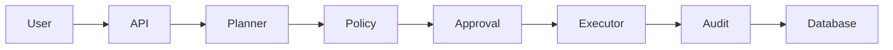

# AI Change Management Agent

## Recommended Repository Name

**ai-change-management-agent**

Alternative professional names:
- ai-governed-change-manager
- autonomous-change-control-platform
- aiops-change-governance
- intelligent-change-orchestrator
- governed-aiops-agent

---

# Project Summary

AI-powered change management platform that generates infrastructure change plans, evaluates risk through policy controls, routes high-risk actions through human approval workflows, executes approved actions, and maintains a complete audit trail.

Target users:
- DevOps Engineers
- Platform Engineers
- Cloud Engineers
- Site Reliability Engineers
- IT Operations Teams

Core value:
Safe AI-assisted infrastructure automation with Human-in-the-Loop governance.

---

# MVP Scope

## Must Have

- Change request submission
- AI planning engine
- Risk classification
- Policy evaluation
- Human approval workflow
- Workflow state management
- Mock execution engine
- JWT authentication
- Audit trail
- REST API
- React dashboard

## Nice to Have

- Slack approvals
- MS Teams integration
- Terraform execution
- Kubernetes deployment execution
- Cost estimation
- Rollback generation
- OIDC SSO
- OpenTelemetry tracing

## Out of Scope

- Production cloud modifications
- Autonomous execution without review
- Multi-region deployment
- Enterprise HA architecture

---

# Architecture Style

Layered Clean Architecture

Presentation Layer
→ Application Layer
→ Domain Layer
→ Infrastructure Layer

Benefits:
- Separation of concerns
- Testability
- Maintainability
- Framework independence

---

# Recommended Stack

Frontend
- React
- TypeScript
- Vite
- React Query

Backend
- Node.js
- Express
- TypeScript

Database
- PostgreSQL
- Prisma ORM

Authentication
- JWT

AI Integration
- OpenAI / Azure OpenAI

Testing
- Vitest
- Supertest

Infrastructure
- Docker
- Docker Compose
- GitHub Actions

---

# Folder Structure

```text
ai-change-management-agent/
├── apps/
│   ├── frontend/
│   └── backend/
├── prisma/
├── docs/
├── .github/workflows/
├── docker-compose.yml
├── Dockerfile
├── README.md
├── .env.example
└── package.json
```

---

# Build Order

Phase 1: Project Setup

Phase 2: Authentication

Phase 3: Change Request CRUD

Phase 4: AI Planner

Phase 5: Policy Engine

Phase 6: Approval Workflow

Phase 7: Execution Engine

Phase 8: Audit Logs

Phase 9: Frontend Dashboard

Phase 10: Testing & CI

---

# Initial Commit Contents

- README.md
- .gitignore
- .env.example
- Dockerfile
- docker-compose.yml
- Backend skeleton
- Frontend skeleton
- Prisma schema
- GitHub Actions workflow
- ESLint config
- Prettier config

---

# Suggested Conventional Commit

feat: initialize AI Change Management Agent MVP architecture

Alternative:

chore: bootstrap project structure and documentation

---

# GitHub Repository Metadata

Repository Name:
ai-change-management-agent

Description:
AI-powered change management platform with policy-driven governance, human approval workflows, risk assessment, and auditable infrastructure automation.

Topics:
ai
aiops
devops
platform-engineering
change-management
workflow-engine
react
typescript
nodejs
openai
clean-architecture
postgresql
prisma
docker
cloud-automation

---

# High-Level Diagram



---

# Learning Goals

Concepts demonstrated:

- Clean Architecture
- SOLID Principles
- Repository Pattern
- DTO Validation
- REST API Design
- JWT Authentication
- Audit Logging
- Human-in-the-Loop Systems
- Dependency Injection
- Environment-Based Configuration
- CI/CD Pipelines
- Dockerization
- Testing Pyramid

---

# Portfolio Value

This project demonstrates:

- Full-stack development
- AI integration
- Distributed systems thinking
- Secure system design
- Workflow orchestration
- Governance and compliance concepts
- Cloud and DevOps architecture
- Production-minded software engineering